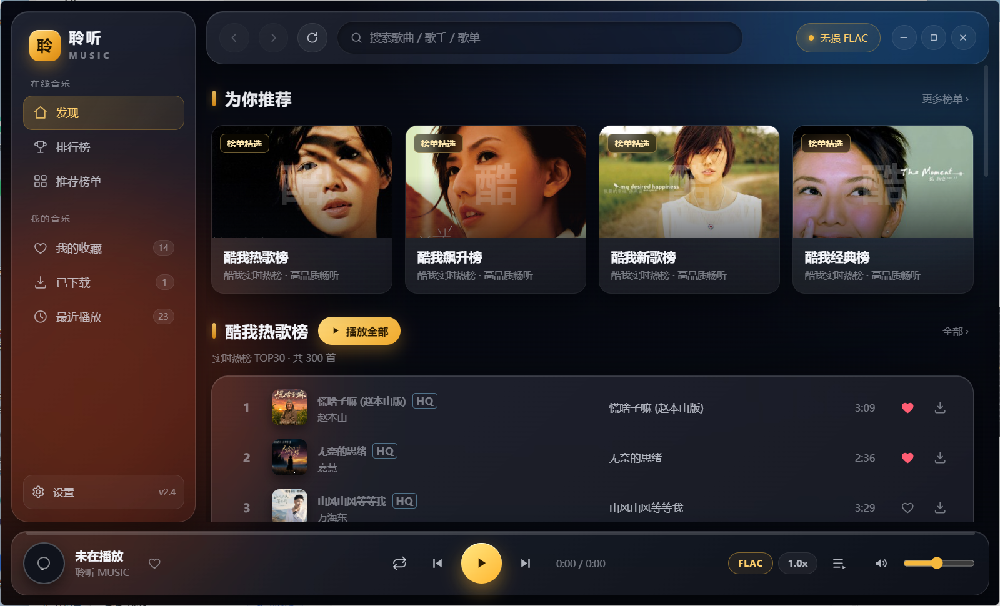
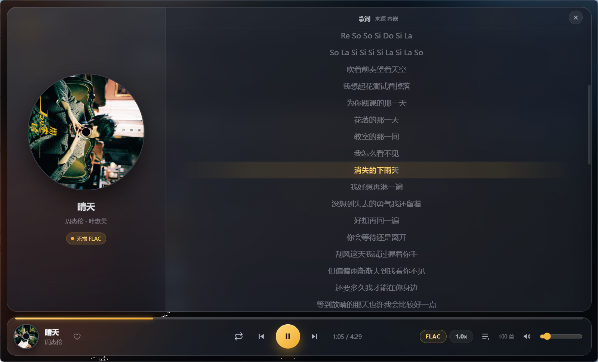
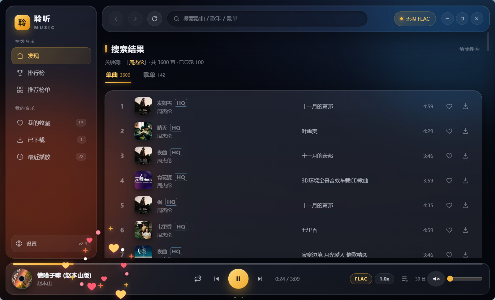

# 聆听 MUSIC · Windows 桌面音乐播放器

把安卓 App「聆听」（`com.miaoda.appesygp1cxis5d`）逆向为 Windows 桌面版，音源为**酷我音乐**。UI 按 `D:\音乐 UI 毛玻璃版.html` 的设计稿重做：毛玻璃 + 琥珀金。

- 技术栈：Electron 33 + 原生 HTML/CSS/JS（无框架、无 Tailwind、无外链字体）
- 界面：无边框窗口 + 自绘标题栏、236px 毛玻璃侧栏、背景大图 + 双色氛围光、玻璃卡片播放栏
- 主题：`--bg:#070a14` / `--gold:#f5b83d` / `--blur:blur(22px) saturate(160%)`
- 音质：标准 128K / 高品质 320K / 无损 FLAC（三档，与手机 App 一致）







**下载安装包**：[Releases · v1.1.4](https://github.com/saviorkkk/listen-desktop/releases/latest)（安装版 / 便携版，Windows x64）


---

## 一、逆向过程

| 步骤 | 说明 |
|---|---|
| 取包 | `base.apk` 48.8MB，包名 `com.miaoda.appesygp1cxis5d` |
| 判型 | Expo SDK55 + React Native + Hermes 字节码（magic `C6 1F BC 03`），Java 层无业务逻辑 |
| 反编译 | 从 `assets/index.android.bundle` 用 `hermes-dec` 的 `hbc_decompiler.py` 还原 JS（36MB / 约 94 万行） |
| 提取 | 从还原的 JS 中定位后端网关、酷我接口、音质档位与歌词来源 |

本地工具：
- 可用 Python：`D:\uv-tools-new\hermes-agent\Scripts\python.exe`
- 反编译脚本：`...\site-packages\hermes_dec\decompilation\hbc_decompiler.py`

---

## 二、接口

### 搜索（全量曲库）
```
http://search.kuwo.cn/r.s?client=kt&all={kw}&pn={page}&rn={size}&uid=0
  &ver=kwplayer_ar_9.2.2.1&vipver=1&show_copyright_off=1&newver=1
  &ft=music&cluster=0&strategy=2012&encoding=utf8&rformat=json
  &vermerge=1&mobi=1
```
移动端全量接口：返回 `abslist[]`，`HIT` 为总命中数（如「孙燕姿」3598 首），`rn` 单页上限 100，`pn` 翻页。
返回是**单引号 JS 对象字面量**（非严格 JSON），用 Node `vm` 沙箱 `runInContext('(' + text + ')')` 解析（禁用 codeGeneration）。
关键字段：`SONGNAME/NAME`、`ARTIST`、`ALBUM`、`ALBUMID`、`MUSICRID`(`MUSIC_xxx`)、`DC_TARGETID`、`DURATION`(秒)、`web_albumpic_short`、`PAY`、`FORMATS`、`ARTISTID`。

### 歌单搜索（与手机 App「歌单」分组一致）
```
http://search.kuwo.cn/r.s?client=kt&all={kw}&pn={page}&rn={size}&uid=0
  &ver=kwplayer_ar_9.2.2.1&vipver=1&show_copyright_off=1&newver=1
  &ft=playlist&cluster=0&strategy=2012&encoding=utf8&rformat=json
  &vermerge=1&mobi=1
```
与单曲搜索同一端点，只把 `ft=music` 换成 `ft=playlist`。`HIT` 为歌单总数（如「孙燕姿」147 个），`rn` 单页上限 100。
关键字段：`playlistid` / `DC_TARGETID`、`name`、`nickname`（创建者）、`pic`(240) / `hts_pic`(700)、`songnum`、`playcnt`、`tags`、`intro`。

### 歌单详情
```
http://nplserver.kuwo.cn/pl.svc?op=getlistinfo&pid={playlistid}
  &pn=0&rn=300&encode=utf8&keyset=pl2012&identity=kuwo&pcmp4=1
  &vipver=MUSIC_9.1.0.0_W1&newver=1
```
返回标准 JSON：`{ id, title, pic(700), info, tag, uname, playnum, total, musiclist[] }`。
`musiclist` 字段：`id`、`name`、`artist`、`album`、`albumid`、`artistid`、`duration`(秒)、`formats`、`MINFO`（各档音质明细）。
> **坑**：`rn` 可一次拉到 300（实测 177 首歌单 `rn=300` 一次全返）；`rn=50` 时 `pn` 翻页正常。`identity=kuwo` 与 `vipver` 两个参数不能省，否则 `musiclist` 直接返回空数组（只剩 411 字节的壳）。

### 播放地址（三档音质 + 内嵌歌词）
App 同源后端，支持 128 / 320 / 无损，并直接返回歌词：
```
GET https://backend.appmiaoda.com/projects/supabase364143248983240704/functions/v1/kuwo-play
    ?rid=MUSIC_{id}&quality={128|320|flac}
Headers: apikey: {匿名 JWT}
         Authorization: Bearer {匿名 JWT}
```
返回 `{ url, lyric }`。实测：`128` → `.aac` br≈100，`320` → `.mp3` br=320，`flac` → `.flac` br=2000。

兜底：`http://antiserver.kuwo.cn/anti.s?type=convert_url&response=url&rid=MUSIC_{id}&format=mp3`（`flac` 会被拒，自动降级到 `320k`）。

### 榜单
```
http://kbangserver.kuwo.cn/ksong.s?from=pc&fmt=json&pn=0&rn=100&type=bang
  &data=content&id={bangId}&show_copyright_off=0&pcmp4=1&isbang=1
```
> **坑**：`qukudata.kuwo.cn` 下发的榜单 id 大多不被 `kbangserver` 识别（返回 `undefined`）。仅老 id 有效，已硬编码 28 个可用榜单：16 酷我热歌榜、93 飙升榜、17 新歌榜、26 经典榜、62 华语榜、22 欧美榜、23 日韩榜、64 影视榜、63 网络榜、68 DJ舞曲榜、69 儿童歌曲榜、65 我是歌手榜、72 中国好声音榜、25/52/53 钱柜KTV榜、18/55 MV榜、1 中国歌曲排行榜、21/20 百度榜、27 中国TOP、12 Billboard、13 UK、14 M-net、15 ORICON、49 iTunes、66 APE无损榜。

### 专辑 / 歌手
```
http://search.kuwo.cn/r.s?stype=albuminfo&albumid={id}&pn=0&rn=100&rformat=json&encoding=utf8
http://search.kuwo.cn/r.s?stype=artistinfo&artistid={id}&pn=0&rn=20&rformat=json&encoding=utf8
```

### 封面
搜索结果 `web_albumpic_short` 形如 `120/s4s4/98/1020404523.jpg`，去掉尺寸前缀，拼 `https://img{1-4}.kuwo.cn/star/albumcover/500/{path}`（多主机轮询）。

按 rid 解析必须走**二次请求**：
```
http://artistpicserver.kuwo.cn/pic.web?type=rid_pic&pictype=500&size=500&rid={id}
```
它返回的是**纯文本图片地址**而不是图片本身，直接当 `` 一定失败 —— 主进程先取这段文本拿到真实 URL 再回传给渲染层。

### 歌词
优先用 `kuwo-play` 返回的 `lyric`（酷我官方，最准）；无则退回网易云：
```
https://music.163.com/api/search/get?s={name+artist}&type=1&offset=0&limit=5   → 取 id
https://music.163.com/api/song/lyric?id={id}&lv=1&kv=1&tv=-1                    → LRC
```

---

## 三、功能

- **发现**：4 张榜单精选卡（封面取孙燕姿专辑图）+ 酷我热歌榜 TOP30
- **排行榜**：28 个榜单 tab，每榜 100 首，带 TOP3 领奖台
- **推荐榜单**：全部 28 榜卡片墙
- **搜索**：顶栏搜索框，下拉展示最近 12 条搜索记录（可点选复用 / 悬停单条点 × 删除 / 一键清除，本地持久化）；结果分「单曲」「歌单」两个分组 tab
  - 单曲：单页 100，「加载更多」翻页（全曲库数千首，如「孙燕姿」3598 首）
  - 歌单：单页 30，「加载更多」翻页；卡片显示封面 / 播放量 / 曲目数 / 创建者；点开进入歌单详情页（封面 hero + 简介 + 标签 + 全部曲目，可整单播放）
- **播放**：单击选中 / 双击播放、上一首 / 下一首、进度拖动、三态播放模式、**倍速（点标签弹 0.5/0.75/1.0/1.25/1.5/2.0 六档网格，当前档高亮，点外部关闭，选择持久化）**、音量、播放队列抽屉
- **预取**：播放成功后自动预取队列前后各 2 首，切歌 0–250ms
- **音质**：点顶栏胶囊或底栏音质标签 → 弹出可选菜单（标准 128K / 高品质 320K / 无损 FLAC，当前档带勾选），点外部关闭；设置页同样三档直选。切换按当前进度重载
- **歌词**：全屏抽屉，**环境壁纸（当前封面放大 124% + blur(90px) + 压暗 veil + 双暖金光晕）** + 黑胶唱片旋转 + **逐字点亮（卡拉 OK 扫光）** + **景深层次（当前行放大/邻居按距离缩小变暗）** + **缓动居中滚动**，右侧歌词区是独立玻璃卡片，点歌词跳转；credit / 广告 / 版权行（含带时间轴的）自动归入顶部灰色信息区，不参与高亮
- **收藏 / 最近播放 / 已下载**：本地持久化（侧栏计数实时同步）
- **下载**：单曲下载到设置目录，自动反查封面（旧条目按「歌名 - 歌手」回填）；批量下载时窗口顶部显示 2px 金色细进度条（按「已完成首数 + 当前首字节进度」合成总进度，全部完成后自动淡出）

---

## 四、目录结构

```
ListenDesktop/
├─ main.js            主进程：搜索/歌单/榜单/专辑/歌手/播放地址/歌词/封面/下载/本地库/窗口
├─ preload.js         安全桥：window.L.*
├─ renderer/
│  ├─ index.html      毛玻璃布局 + 全部 CSS（自写，无外链）
│  └─ app.js          状态机、页面渲染、播放核心、歌词、封面懒解析
├─ build/             图标（icon.ico / icon_*.png）
└─ package.json       构建配置（electron-builder）
```

---

## 五、构建与运行

```bash
# 开发
npx electron .

# 打包（Windows）
set ELECTRON_MIRROR=https://npmmirror.com/mirrors/electron/
set ELECTRON_BUILDER_BINARIES_MIRROR=https://npmmirror.com/mirrors/electron-builder-binaries/
npx electron-builder --win --x64
```

产物：
- `dist/聆听-1.1.2-安装包.exe`（NSIS）
- `dist/聆听-1.1.2-便携版.exe`
- `dist/win-unpacked/聆听.exe`

> Windows 下 electron-builder 无符号链接权限会致 `winCodeSign` 解压失败：手动把 `winCodeSign-2.6.0.7z` 解到 `%LOCALAPPDATA%\electron-builder\Cache\winCodeSign\winCodeSign-2.6.0\`，用 `7za x -x'!darwin'` 排除符号链接。

部署：`robocopy dist\win-unpacked D:\Desktop\nixiang\聆听\app /MIR`（返回 1 表示成功），桌面快捷方式 `D:\Desktop\聆听.lnk` 指向 `app\聆听.exe`。

---

## 六、UI 设计要点

| 项 | 值 |
|---|---|
| 背景 | `.ambient` 固定层：`radial-gradient(#1c2f52, #33200f)` + 模糊大图 + `.veil` + 双色光晕 `#7a2d16` / `#173d5c` |
| 玻璃 | `--glass: linear-gradient(135deg, rgba(255,255,255,.10), rgba(255,255,255,.045))` + `backdrop-filter: blur(22px) saturate(160%)` |
| 侧栏 | 236px，`brand-mark` 40px 圆角渐变金字「聆」，导航 44px 高，底部设置入口 |
| 播放栏 | 82px，进度条浮在顶部 `-5px`，金色渐 fill + 12px knob，唱片 54px 带 13px 中心孔（`body.playing` 才转） |
| 卡片 | `repeat(auto-fit, minmax(212px, 1fr))`，`aspect-ratio: 16/10`，右下角 40px 播放圆钮 hover 浮出 |
| 歌曲表 | `grid: 44px minmax(0,1.9fr) minmax(0,1.2fr) 64px 92px`，行高 64px，`.eq` 三柱动画标识正在播 |
| 歌词层 | `grid-template-rows: minmax(0,1fr)` + 左右栏 `min-height:0`，否则内容会把整层撑到 2000+ px |
| 滚动条 | 只写 `::-webkit-scrollbar`（8px，thumb `rgba(255,255,255,.14)` + `border:2px solid transparent;background-clip:padding-box`）。**一旦写 `scrollbar-width`，Chromium 就退回系统浅色 Fluent 滚动条**，`::-webkit-scrollbar` 全失效 |
| 音质浮层 | `.qpop` 固定定位 208px 玻璃面板，`openQpop(anchor)` 用 `getBoundingClientRect()` 优先在按钮上方弹出，不够则下方，左右/上下都 clamp 到视口 10px 内 |
| 底栏形状 | 音乐控制键为圆（42/52px `r=50%`），音质/倍速为同高胶囊（28px `r=99px`），不再混三种形状 |
| 窗口拖拽 | 顶栏内嵌一层不带 `backdrop-filter` 的 `.drag-handle` 用 `-webkit-app-region:drag`；主进程 `setMaximizable(false)` 阻断双击标题栏最大化 |

---

## 七、注意事项 / 已知限制

- **DPI**：窗口按主屏工作区自适应（`screen.getPrimaryDisplay().workAreaSize`），125% 缩放下不超出屏幕。
- **ELECTRON_RUN_AS_NODE**：某些 shell 环境带 `ELECTRON_RUN_AS_NODE=1`，会让 Electron 以 Node 模式启动秒退（报 `app.getPath undefined`）。启动前需清除该环境变量。
- **中文文件读写**：改 `renderer/index.html` 必须用 Node `fs`，PowerShell 的 `Get-Content -Raw` + `WriteAllText` 会写出 mojibake（`鑱嗗惉`），且控制台显示是假象。
- **截图**：CDP `Page.captureScreenshot` 会挂死；`PrintWindow` 在 GPU 渲染下返回全黑。用 `capture_pid.ps1`（`SetWindowPos` TOPMOST + `CopyFromScreen`）。
- **窗口拖拽（踩了三个坑，最终方案）**：
  1. 直接给 `.topbar`（带 `backdrop-filter` 的玻璃层）设 `-webkit-app-region:drag` —— 计算值确实是 `drag`，但 Chromium 不把命中转成 `HTCAPTION`，鼠标按住拖不动。
  2. 改用主进程 `setInterval(8ms)` 轮询 `screen.getCursorScreenPoint()` + `win.setPosition()` —— 125% DPI 下 DIP↔物理像素往返舍入，每次拖拽窗口高度 +1~2px（970→971→973→975），越拖越大，`setBounds` 和 `setSize` 回写都拦不住。
  3. 原生拖拽能用了，但**第一版我给拖拽区绑了 `dblclick` → `winMax()`**，用户单击顶栏后再按住拖，被浏览器算成双击，直接最大化 —— 这就是「一拖动它就自动变大」的真正原因。
  **最终方案**：顶栏内嵌一层 `.topbar>.drag-handle`（`position:absolute;inset:0`，不带 `backdrop-filter`）设 `-webkit-app-region:drag`，其余控件 `no-drag`；主进程 `win.setMaximizable(false)` 让 Windows 不再把标题栏双击解释成最大化；自绘最大化按钮改走 `win:max` 手动 `workArea` 铺满 + `restoreBounds` 还原。实测连拖 5 次尺寸恒为 1600×970、双击顶栏无动作、最大化/还原正常。
- **自动化测试拖拽的坑**：用 `mouse_event` 模拟拖拽前必须先 `SetForegroundWindow(h)` 把目标窗口提到前台，否则鼠标事件落在别的窗口上，窗口不会移动（表现为「代码没问题但测不出来」）。且坐标要用 `SetProcessDPIAware()` + `物理 = 窗口左上 + CSS坐标 × 1.25`（125% 缩放）。PowerShell 里不要把辅助函数命名成 `R`（与 `Invoke-History` 别名冲突）。
- 无损音质依赖账号/版权，个别歌曲后端可能返回标准音质或需降级到 320。
- **歌词 credit 过滤**：`isLyricJunk()` 按「作词/作曲/编曲/制作人/录音/混音/出品/监制…」前缀 + 广告词表 + 短标签行（≤22 字带冒号）判定，命中即归入 `out.meta`，即使它带时间轴也不进正文；`isTitleLine()` 只在**前 3 条时间轴内**剔除「歌名 - 歌手 (英文名)」这种 LRC 自带标题行，避免误杀正文里带破折号的句子。
- **逐字歌词（卡拉 OK 扫光）**：不能靠 `::selection` 或逐字包 span（LRC 只给整行时间戳，没有字级时间），做法是把每行文字包进 `.ly-tx`，用 `background-image: linear-gradient(90deg, 金色 0 var(--p), 暗色 var(--p) 100%)` + `background-clip:text` + `-webkit-text-fill-color:transparent`，JS 按 `(currentTime - t0) / (t1 - t0)` 每帧写 `--p` 百分比；`t1` 取下一条时间戳、最后一行按字数估（`max(2.4, 字数×0.32)` 秒）。三个坑：① 不能给 `.ly-line.active` 留 `text-shadow`，否则在 `-webkit-text-fill-color:transparent` 下会透出整行模糊光影，改用 `.ly-tx` 的 `filter:drop-shadow`；② `timeupdate` 只有 ~4Hz，逐字会一顿一顿，必须用 `requestAnimationFrame` 循环（`startLyricTick/stopLyricTick`，随歌词层开关启停），且 `--p` 的更新要放在 `updateLyricHighlight()` 早退 `return` **之前**；③ **歌词"跟不上"的根因是 `state.currentTime` 只在 `timeupdate` 里刷新（最多滞后 250ms）**，修法是让 rAF 每帧执行 `state.currentTime = audio.currentTime`。
- **歌词动态效果**：`--d` = 与当前行的行距（JS 在活动行变化时一次性写全部行），CSS `transform:scale(calc(1 - var(--d)*.016))` + `opacity:clamp(.14, calc(1 - var(--d)*.155), 1)` 做景深；当前行 `scale(1.035)` + 金色渐变底条 + `lyBreath` 呼吸（**只动画 opacity，不要动画 filter:drop-shadow，后者每帧重绘文字，白掉 10fps**）。滚动居中改成 `LY_TARGET` 目标值 + rAF 里 `scrollTop += (target - scrollTop) * 0.2` 缓动（差值 >420px 直接落位，避免拖进度条时缓慢划过）；`lyricAnchor()` 只在换行时量一次 `getBoundingClientRect`，每帧量会强制同步布局同样掉帧；用户滚轮/触摸滚动后 `LY_HOLD = now + 3000` 暂停跟随，到期再用 `LY_ACTIVE_EL` 重新定位一次。
- 实测（打包版）：`state.currentTime - audio.currentTime` ≈ -0.02s；`--d` 0/1/2/3 对应 opacity 1.00/0.84/0.69/0.54、scale 1.033/0.985/0.968/0.952；换行时 scrollTop 序列 376.8→389.6→398.4→404→408→410.4→412→413.6（缓动收敛）；歌词层开启 ~42fps、关闭 ~50fps（该机基线即 50）。
- **歌词页环境壁纸（对齐 D:\音乐 UI 毛玻璃版.html 的 `.ambient`）**：`.lyrics` 内的首个子节点 `.ly-amb` 为 `position:absolute;inset:0;z-index:0`，内含 ``（`inset:-12%;width:124%;height:124%;object-fit:cover;filter:blur(90px) saturate(150%) brightness(.62);opacity:.55`）、`.veil`（径向 + 竖向双层压暗）、两个模糊色块 `.ga/.gb`（`#8a3d12` / `#6b3a10`）；grid 子项 `.ly-left/.ly-right` 提到 `z-index:2`。底图在 `updateNowPlaying()` 里与主页 `#ambientImg` 同源取 `rawCovers[0] || t.cover`，只有 rid 时延后 900ms 从 `#lyricsCover img.cimg` 读回真实 src 再铺。右侧歌词区 `.ly-body` 从透明改成玻璃卡片（`margin:12px 14px 14px` + `linear-gradient(135deg,rgba(255,255,255,.065),...)` + 1px `--stroke-soft` + `border-radius:var(--r-md)`），标题 `.ly-head b` 前加 4px 金色竖条（对齐 `.sec-head`）。⚠ `.ly-amb` 必须是 absolute，不能进 `.lyrics` 的 grid 流（否则被当成一列）。⚠ `capture_pid.ps1` 抓 GPU 合成窗口常拿到上一帧（整块卡片/底栏缺失或残影），判读前先看 CDP 数值，或连拍两张取第二张。
- **动态效果（对齐 D:\音乐 UI 毛玻璃版.html 的 jelly 交互）**：`:root` 增 `--spring:cubic-bezier(.34,1.56,.64,1)` 与 `--spring-soft`；`jellySquash / jellyPop / jellyIn / jellyFloat / heartBeat` 五个 keyframes 原样移植。生效点：卡片与歌曲行入场 `jellyIn`（`nth-child` 0/0.03/0.06/0.09/0.12/0.15s 阶梯延迟）、`.card:hover{transform:translateY(-5px) scale(1.015,.995)}`、按钮 `:active` → `jellySquash`、`.play-btn:active` → `jellyPop`、`body.playing .play-btn` → `jellyFloat` 呼吸、`.op-btn.liked svg` → `heartBeat`、`.row:hover .song .cwrap img` → `scale(1.07) rotate(-1.5deg)`、`.brand:hover .brand-mark` 旋转、`.search:focus-within` 轻压、`.progress:active .knob` 按压、`.sidebar/.topbar/.player` `jellyIn` 入场。全局 `pointerdown`（捕获阶段）给 `button/.card/.chip/.nav-item/.ctl/.op-btn` 加 `.jelly-press`（先 `void offsetWidth` 重启动画，560ms 后移除）。
- **点赞粒子**：`#particleLayer`（`position:fixed;inset:0;z-index:9999;pointer-events:none`）。`spawnLikeParticles(cx,cy,big)`：先一枚 expanding ring（14px→scale 3.2、520ms），再 14（big 时 18）枚三类粒子按 `i%3` 交替（心形 SVG / 圆点 / 「+」文字），颜色取 `LIKE_COLORS` 六色，角度均分 + 随机扰动，WAAPI 三段关键帧 `translate(-50%,-50%) translate(dx*.72,dy*.72) scale(1.15)`（offset .55）→ `translate(dx, dy+34) scale(.55)` opacity 0，`cubic-bezier(.22,1.2,.36,1)`；末尾再放一枚上升主心形（820ms）。触发：行内 `[data-act="fav"]` 由未收藏→收藏（`big=false`，按钮同时加 620ms `.like-burst`）、底栏 `#nowLike`（`big=true`，以按钮中心为原点）。⚠ **粒子元素必须写 `left/top = cx/cy`，关键帧里的 `translate(-50%,-50%)` 只做居中**；left/top 写成 0 会让整簇粒子从窗口左上角飞出去（表现：左上角一条残影带）。
- **播放中行内的进度条**：`.row` 加 `position:relative`，行模板末尾插 `<div class="row-progress"><i></i></div>`（`absolute;left:14px;right:14px;bottom:5px;height:3px`，仅 `.row.playing` 显示），`updateProgressUI()` 每次同步 `.panel.glass .row.playing .row-progress i` 的宽度；`.eq` 三柱在暂停时由 `body.paused .eq i{animation-play-state:paused}` 冻结。
- `prefers-reduced-motion: reduce` 下：`#particleLayer{display:none}`、入场动画 `animation:none`、`*{transition:none}`；JS 侧 `reduceMotion` 为真时既不生成粒子也不做按压回弹。
- 音源为第三方公开接口，可能随上游变更失效；接口异常时以「播放失败」提示，不做静默伪造。
- **下载进度事件字段**：主进程 downloadOne 每 300ms 回调节字节数 {got,total}，dl:batch 转发为 {index,count,title,got,total,done}；	otal 是**当前文件字节数**、count 是**本批首数**。曾把首数也写进 	otal，结果被 ...p 展开覆盖，进度算成 0；改外层为 count 后正常。渲染端 handleDlProgress() 用 (index + got/total) / count 合成总进度，写到顶部 2px .dl-strip。
